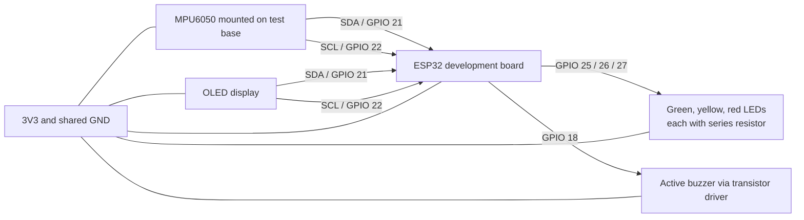

# ESP32 Seismic Activity Detection (C / ESP-IDF)

This is a learning prototype written in C for ESP-IDF. It detects unusual vibration; it does not predict earthquakes or replace official monitoring. The application entry point is `app_main()` in `main/main.c`.

## Hardware

- ESP32 development board
- MPU6050 accelerometer/gyroscope module
- 128 x 64 I2C OLED at address `0x3C`
- Green, yellow, and red LEDs, each with a suitable current-limiting resistor
- Active buzzer

## Wiring

Power off the ESP32 while wiring. Use the pin labels printed on your ESP32 development board; GPIO numbers below are not necessarily the physical header-pin positions.

| ESP32 connection | Connect to |
| --- | --- |
| 3V3 | MPU6050 VCC and OLED VCC, if those modules support 3.3 V |
| GND | MPU6050 GND, OLED GND, LED cathodes, and buzzer-driver GND |
| GPIO 21 (SDA) | MPU6050 SDA and OLED SDA |
| GPIO 22 (SCL) | MPU6050 SCL and OLED SCL |
| GPIO 25 | Green LED anode through a 220-330 ohm resistor |
| GPIO 26 | Yellow LED anode through a 220-330 ohm resistor |
| GPIO 27 | Red LED anode through a 220-330 ohm resistor |
| GPIO 18 | Active buzzer driver input, as described below |

For each LED, connect its cathode (the shorter leg) to GND. The resistor may be placed on either side of the LED, but it must be in series with it.

The MPU6050 and OLED share SDA, SCL, 3V3, and GND. Confirm the labels and voltage requirements for your exact modules before powering them. Do not connect a 5 V I2C signal to an ESP32 GPIO.

### Connection diagram

The ESP32 is the controller at the center of the setup. `diagram.json` contains the Wokwi circuit. This is a signal map, not a physical board pin-layout drawing; connect to the GPIO labels on your physical board.



Do not connect an unknown buzzer directly to GPIO 18 on physical hardware. For a typical two-wire active buzzer, use a suitable NPN transistor: buzzer positive to its rated supply, buzzer negative to the transistor collector, transistor emitter to GND, and GPIO 18 to the base through about a 1 kOhm resistor. Join the buzzer supply ground to ESP32 GND. Choose a transistor and supply that match the buzzer current; add a flyback diode if the buzzer is magnetic/inductive. In the Wokwi diagram the buzzer is connected directly for simulation.

## Build With ESP-IDF

1. Install ESP-IDF 5.x using Espressif's Windows installer and open the ESP-IDF Command Prompt.
2. Change directory to this project folder.
3. Set the target and build:

	```text
	idf.py set-target esp32
	idf.py build
	```

4. To run on a real board, connect it over USB and run `idf.py -p COMx flash monitor`, replacing `COMx` with the board's COM port. The serial log runs at 115200 baud.

No Arduino libraries are needed: the C program talks to the MPU6050 and SSD1306 over I2C using ESP-IDF's driver.

## Run In Wokwi

The project includes `diagram.json` and `wokwi.toml`. Install the Wokwi extension for VS Code, open this project folder, build it with ESP-IDF, then start the Wokwi simulator. The simulator uses the compiled firmware from `build/` and the ESP32 circuit from `diagram.json`.

Use the MPU6050 controls in the simulator to change acceleration. The default still reading is X=0g, Y=0g, Z=1g. Raise X to create vibration; hold it high to reach ALERT, then return X to 0g to let the alert clear. The firmware reports the vibration and state in the serial monitor and updates the OLED and outputs.

## Demonstration setup

1. Fix the MPU6050 firmly to a small test platform. Place the ESP32 and OLED beside it, with the display and LEDs visible to the audience.
2. Wire the parts using the table above, then connect the ESP32 to the computer with USB and flash the firmware.
3. Open the ESP-IDF monitor at `115200` baud. With the platform still, show the NORMAL state and green LED.
4. Gently tap or move the platform to show WARNING, then sustained vibration to show ALERT, red LED, and buzzer. Do not shake the board hard.

The ESP32 is the controller, not the vibration sensor. The MPU6050 should be attached to the test platform so it senses that platform's motion; keep the ESP32 and wiring secure during the demonstration.

The pin numbers, sensor thresholds, and timing values are defined near the top of `main/main.c`. The default WARNING threshold is `1.2 m/s^2`; ALERT begins after vibration remains above `2.5 m/s^2` for `500 ms`. After an alert, the reading must remain below `0.8 m/s^2` for one second to clear it. Tune these values on the final mounting surface; nearby movement can cause false alarms.